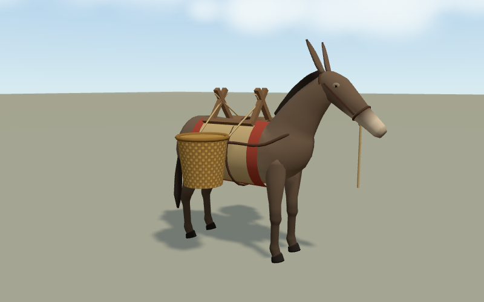
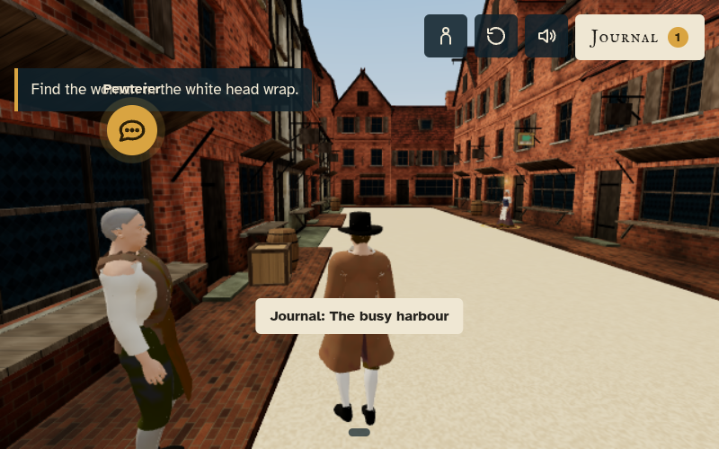

# Game quality fixes

This patch corrects the repeated colour transfer in legacy character exports, releases held input on lost focus, fixes Bog Walk's choice/torch overlap and autoplay loop, keeps carried cases clear of bent elbows, and skips work for Garvey's hidden characters. Eventide remains available to build locally but is excluded from the public distribution while it is unfinished.

Lewis Galdy's visible walk now uses the steadier WalkM clip, tracks real movement instead of the footstep accumulator, faces the direction travelled, adjusts pace for hurrying, and pins feet to the ground after animation. A new `?test=walk` view exercises the real controller, including starting, stopping, backward/sideways movement, loop seams and several footstep-counter resets.

Run `npm test` for regression cases covering the colour transfer, already-correct exports, input loss, rotated collision boxes, carrying poses and walking. Serve the repository and open `tests/ui-audit.html` for the browser fixtures: padded headings and clipped scroll text must not cause false positives, while real text/button collisions must still be detected.

Run the game checks documented in TESTING.md. Bog Walk's audit uses only active actions; its box checks use local box coordinates, and its fruit is attached to canopy clusters. The layout audit uses painted text rather than paragraph padding and respects scrollable end cards. These changes retain real mesh/control and seated-pose checks.

The older coverage gaps in Port Royal and Garvey's full shared place/held/layout hooks are not filled by this patch. Their chapter playthroughs and the targeted browser checks remain necessary. Physical-phone FPS and complete gamepad coverage still need device testing.

Space, Enter and E now talk to the nearest character or use the nearest object while focus is in the game world. Focused buttons retain their native keyboard behaviour, so dialogue choices and menu controls do not activate twice. Text fields keep their normal keys. Holding an interaction key does not repeatedly open conversations.

The Kendal mule now has one continuous body/neck surface, smoother cross sections, outward-facing end caps, and curved breast/croup straps. Its pack slots and load animation are retained; its collision footprint now covers the head and panniers. The held-item audit samples twelve poses per carried item rather than one random instant.

## Checked views

Validation: nine Node regression tests pass; browser layout fixtures pass all four assertions. Bog Walk and Kendal layout checks report zero issues at 390x800, 667x375, 800x500 and 1280x720. Their place and held-item checks report zero issues, with Kendal now sampling twelve poses per held item. Port Royal's visible-walk controller reports `WALK 0`, including no idle flicker, grounded feet and closed loop seams. Space and Enter both open conversations in browser checks for all four released games. All chapter playthroughs were exercised, including the repaired full Bog Walk autoplay and Kendal's mule-loading chapter.

Legacy character swatches and a small Blender export also verify the colour transfer and the linear scene marker. The full MakeHuman character library is not regenerated; existing packed bodies are repaired once when loaded. New exports use float colour layers and carry the marker to avoid that repair.
