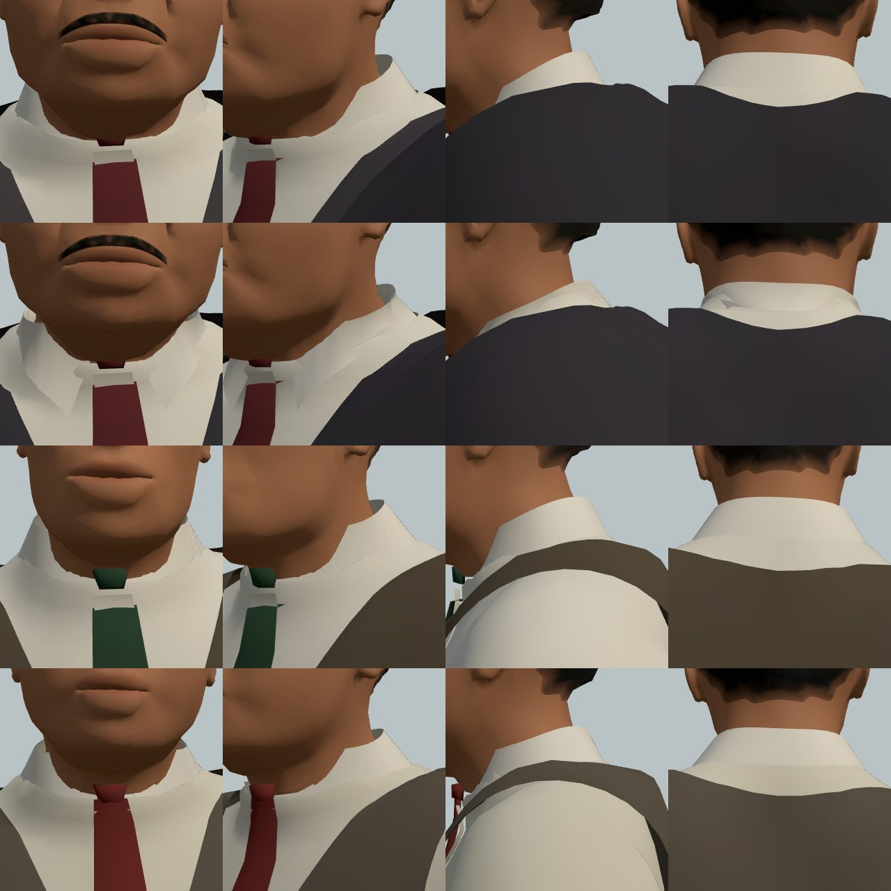
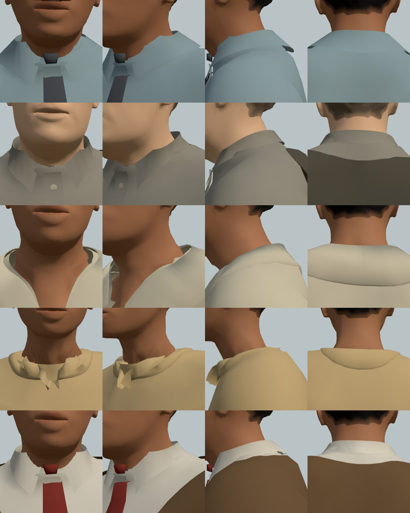
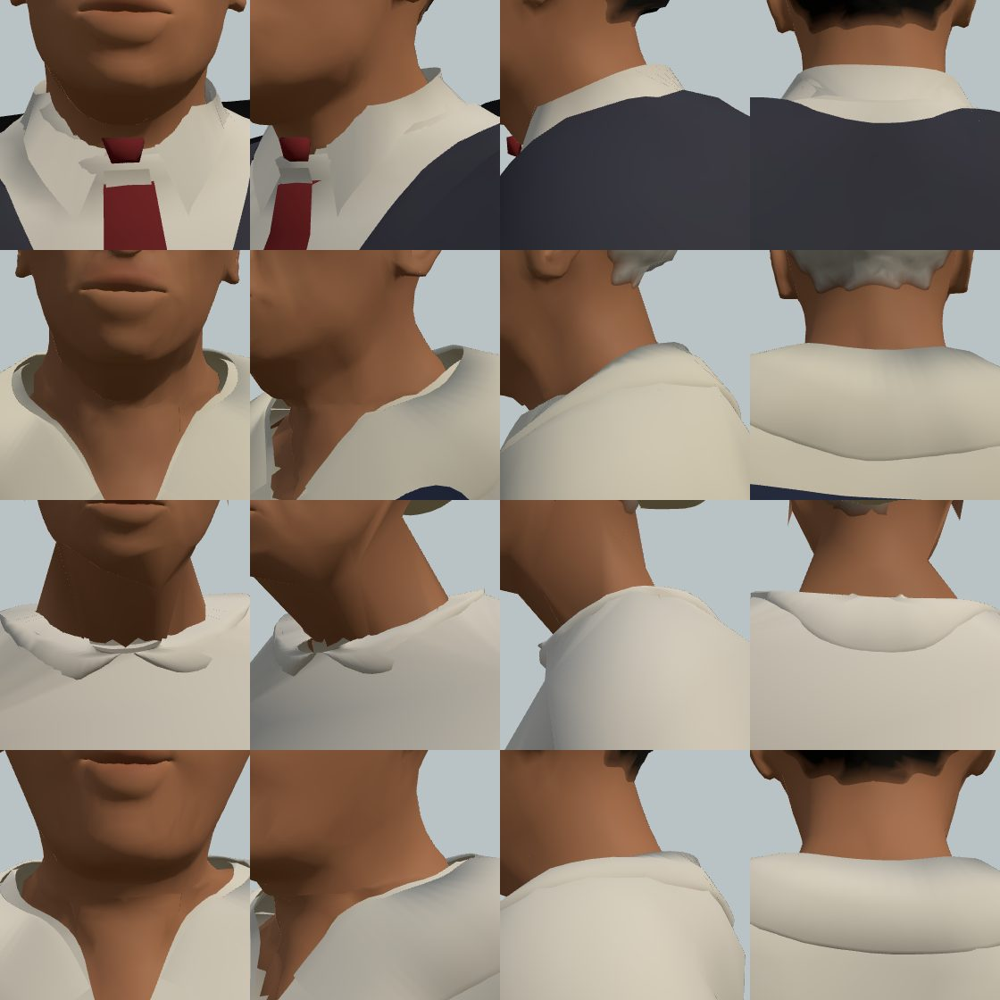
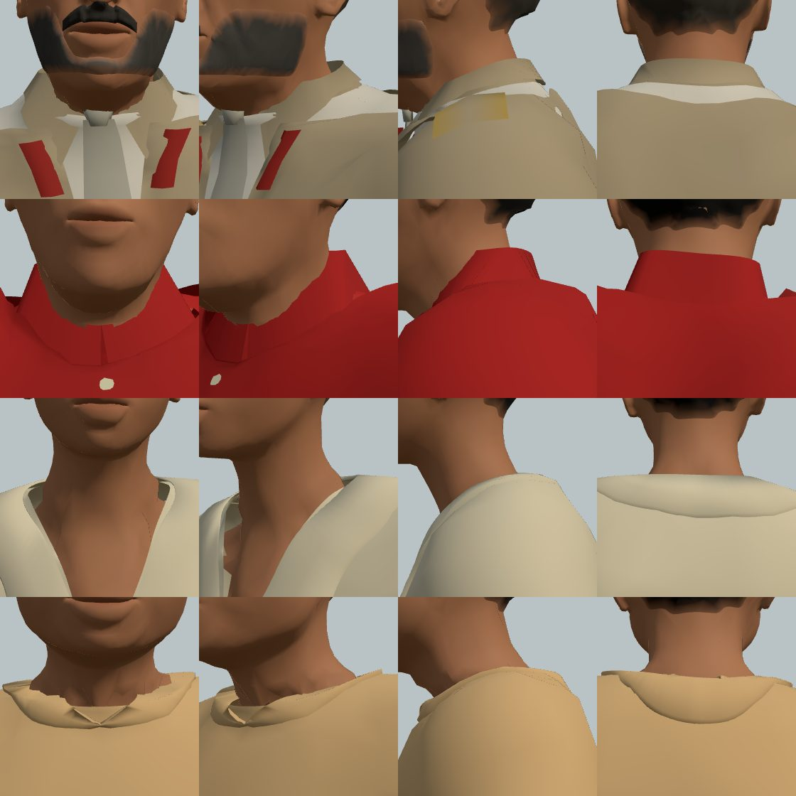
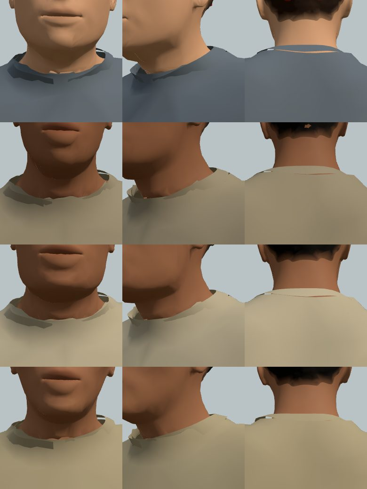
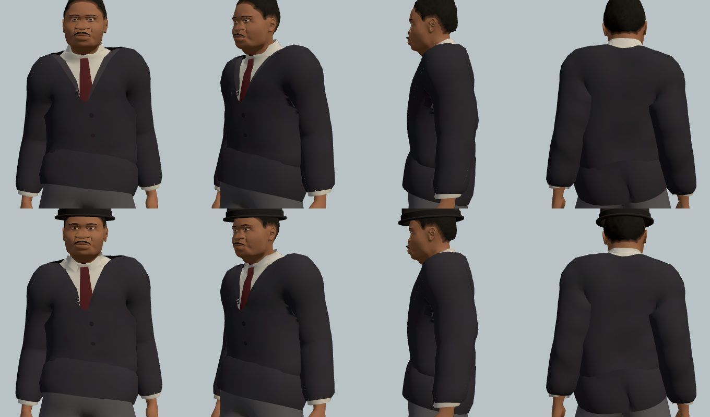

# Collars and ties: audit and rebuild, 21 November 2026

The owner: "the collars of most of the characters are messed up, jagged and not smooth, or laying flat and properly shaped. I suspect that numerous fixes on them have made them messed up. I just want to start over and model ties and collars correctly. This is an issue throughout all games." Also: "Marcus Garvey's suit is shaped funny at the top by his shoulders and looks like padding."

## What was found

Close views of the neck (front, three-quarter, side, back) of bodies from Garvey, Windrush, Kendal, The Emperor's Arrival, Port Royal and Nanny Town, as shipped on main:

- **Jagged edges everywhere.** A stand collar's top edge was ragged; above every flat collar the neck skin ended in a saw-tooth line.
- **Crumpled and torn collars.** Turn collars folded into lumps; a round collar tore into shards at the throat; a camp collar's back rolled up like a sausage.
- **Ties in two pieces.** A tiny box for a knot, a white gap, then a flat three-point strip for the blade.
- **The 1690s neckband** (Port Royal's working men, Nanny Town's Maroon men) was ragged and showed gaps at the back.

## Why

The owner's guess was right. The collar was a separate strip floating near the shirt, and it had been patched many times.

1. Every point of a collar was placed by casting one ray, or finding the nearest point, onto cloth that was itself made by pushing the body's skin outward. That cloth is lumpy, so neighbouring points landed at different depths: saw teeth.
2. About a dozen later passes tried to iron the teeth out: a running median, smoothing, lifts against the skin, lifts against the shirt, laying back onto the shirt, then lifting again. Each pass fixed one picture and broke another. The file had 132 mentions of "collar" and 19 notes saying "owner, 17 November 2026".
3. The collar was not joined to the shirt. Collar and shirt had separately copied bone weights, so in a pose the gap between them opened. Further passes pushed neck skin inward point by point to hide the gap, and that push is what left the saw-tooth edge of skin above every collar.
4. The middle of the neck was guessed from an ellipse of three measurements, and the collar's weights were copied from the skin of the neck, which follows the head.

The suit: the jacket was fitted over the whole shirt and waistcoat, including the shirt's baggy sleeves and the waistcoat's back, which are cut away later because nobody can see them. A band of shirt kept at collar height also ran out across the tops of the sleeves. So the jacket stood out over his shoulders like padding. With the jacket hidden, the leftover shirt stuck out from his shoulders like wings:

## What was done

Collars and ties were started again in a new file, `tools/garvey/neckwear.py`, which replaces the old code for every shirt with a collar (details in `docs/PIPELINE.md`, "Collars and ties, rebuilt").

- **Attached to the shirt.** The shirt's neckline is cut to one smooth seam line and the collar's first row is built on the shirt's own edge points, with the same bone weights. They are one seam and cannot part.
- **Shaped from a smooth neck**, a low-pass outline of the skin, with the neck's middle measured properly.
- **Leaves laid along the cloth**, resting on the outer hull of what is beneath, so they span a waistcoat's edge instead of climbing it.
- **The collar and knot move with the chest**, as a shirt collar does.
- **The tie is one piece**: a flat, tapered four-in-hand knot reaching the band's top edge, and a blade that runs on from inside it, stiff over the shirt.
- **Kinds by period**: stand (before about 1925), turn, open, round and camp (1950s), the narrow neckband of a 1690s shirt worn open at the slit (Port Royal's working men), and a plain rounded opening (Nanny Town's Maroon men, at the owner's request).
- **The suit**: the jacket is fitted over only what stays under it, lies about 1 cm off the layer beneath across the top of the shoulders, and has slimmer sleeves.

Every body in every game was rebuilt with `tools/people/rebuild.mjs`. Results and pictures after: see "After" below.

## Research: necklines by period and climate

- **1690s Port Royal.** Shirts of the time, for gentlemen and labourers alike, were cut from rectangles and gathered into a narrow neckband over a short slit at the front. A V&A man's shirt of about 1697 to 1702 has a 2½ inch collar fastened with three buttons; the V&A notes the shirt barely changed from the 1500s to the mid-1800s. Working shirts were the same cut in coarse linen (osnaburg). So Port Royal's working men keep a narrow band, built low and open at the slit, as a man would wear it in the heat.
- **1730s Windward Maroons.** No description of their shirts survives. The one line about a Leeward Maroon captain in 1738 describes loose drawers to the knee, a small round hat and no shirt. Nanny Town's Maroon men now have a plain rounded opening with no band, as the owner asked. A band would not be wrong for a shirt of the period, but nothing records one here.
- **Enslaved people in Jamaica** were given cheap osnaburg cloth for shirts and trousers, or shifts and petticoats, as Jamaican law required; the allowances were inadequate for the work and the climate.

Sources: V&A shirt, c. 1697 to 1702 (collections.vam.ac.uk/item/O366237); Colonial Williamsburg man's shirt, 1775 to 1790 (emuseum.history.org/objects/42096); FutureLearn, Slavery in the British Caribbean (futurelearn.com/info/courses/slavery-in-the-british-caribbean/0/steps/162122); the Leeward captain: `docs/games/nanny.md`, "Research".

## Still to do

- A suit jacket has no collar of its own. A suit's collar round the back of the neck, running into the lapels, is what makes its shoulders read as tailored; without it Garvey's jacket still looks soft. Changing Garvey's body was tried (a smaller shoulder muscle, a less doubled neck) and made almost no difference, so his likeness was left alone.
- A child's narrow chest creases a camp collar's facings a little (Kendal's `boy`).
- A turn collar pressed between a waistcoat and a jacket creases a little beside the knot (`garvey1916`).
- A round collar on a soft, rounded blouse follows the blouse's lumps.
