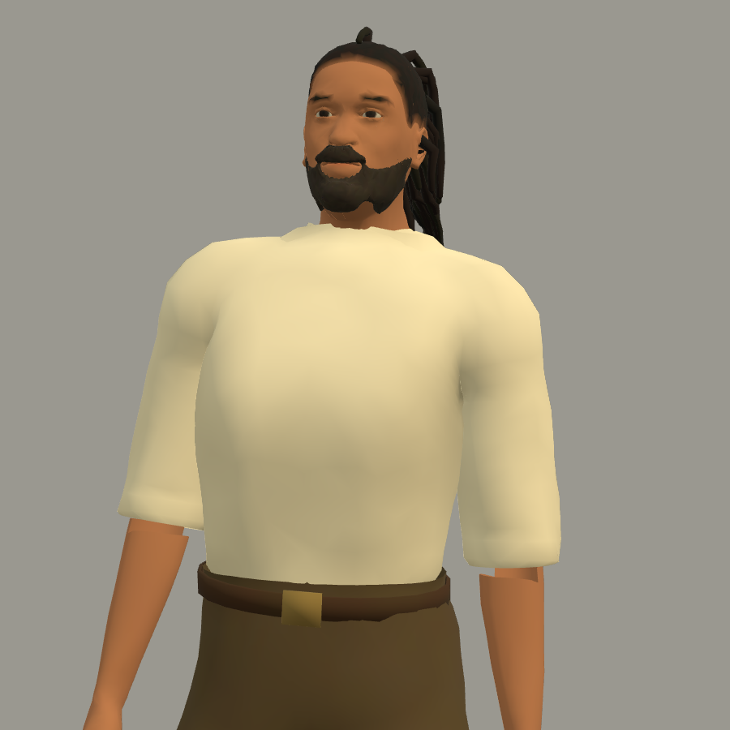
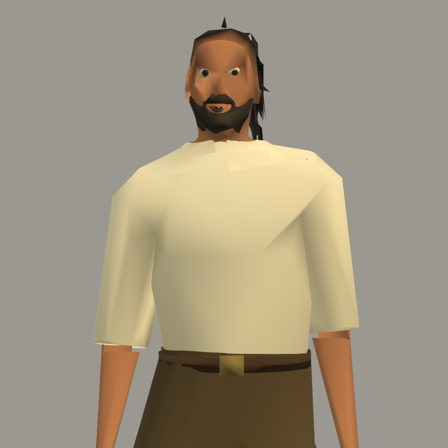

# Outstanding branch consolidation review

Review date: 16 November 2026 (America/Jamaica).

Base: `main` at `3aa66d351de005891ecb5e9d0c6703ee468f8aab`. The remote was fetched again before publishing. This PR combines branch work for review; it does not merge main or deploy.

## Coverage

Reviewed all 44 non-main remote branch heads and ten local branches. Fifteen remote heads contained commits outside main; the other 29 were already ancestors of main. All reviewed heads are ancestors of this integration branch. Source branches are retained.

The largest source branch is `claude/affectionate-pasteur-xvhvlq`. It includes the Garvey, Kendal, Selassie, Windrush and shared UI review branches. Other helper branches were compared against this newer combined implementation before resolving overlaps.

## Conflict decisions

- Keep the newer Tivoli book journal, chapter controls and mobile layout. Older parity helpers did not replace them.
- Keep the newer Nanny mobile title poster and chapter footer. Preserve the live desktop soldiers scene and motion.
- Restore the brass menu card border and shadow from the menu polish branch.
- Keep the newer detailed Windrush ship thumbnail, including the bow name.
- Record superseded helper branches with ancestry-only merges after comparing their changes, so the PR accounts for the branch without restoring old implementations.
- Local `fix/game-quality-and-continuity` contact-pill work and `fix/nanny-live-title` were superseded by newer integrated fixes. Their committed tips are accounted for; uncommitted files in the original worktree were left untouched.

## Issues fixed during review

- Shared ambient character tracking could turn a speaking body to NaN when player coordinates were explicitly undefined or NaN during loading. Sanitize those values before body and head tracking; the new regression failed before the fix.
- Shared continuity checks compared independent chapter and step replays as one timeline. Keep each replay separate while still detecting undeclared changes within a replay.
- Camera samples are checked against the place in which they were captured. Added a regression for identical coordinates in different places.
- Nanny declares Beneba's grown-up hat change in its continuity table.
- Port Royal keyboard focus now follows the visual HUD order.
- Port Royal map probes now verify exact reached points instead of treating nearby points inside fort walls as walkable. Boundary probes skip blocked starting poses while continuing to catch actual escapes.
- Kendal bench footprints now declare their physical height, so the camera check does not treat low benches as full-height walls.
- Nanny's uphill camera smoothing keeps the lens above the terrain.
- The Windrush route-card task now points at the clear approach in front of the map table, outside the new ship cabin footprint. Camera probes retain the drawn scene while chapter state is changing.
- Six older games keep the standard Unlock All and Restart chapter labels at runtime, instead of overwriting the HTML labels.
- Switching Tivoli chapters now removes the old walking scene and story people first. The browser reproduced six people in chapter 2 before this fix. The read-instead route also stops the old walk, and stale title timers are cancelled.
- Selassie crowd locs now root in visible scalp/hair geometry, with the first two rings following the head. The previous root fit included hidden MakeHuman helper shapes. Beards follow the skin bone weights and use a full jaw contour. The five Rastafari recipes use narrow neckbands; male shirt fronts receive a skin-clearance fit. Updated the airport thumbnail from the actual game render.
- The menu badge regression now checks all ten cards by game identifier, including Port Royal and Bog Walk.

## Substantive source changes to review

The incoming contributor rule allows clearly labelled imagined everyday words for some real people, as recorded in the source branch. Garvey still uses only sourced words; Nanny never speaks; Selassie and Planno have no invented words. This is a content-policy change as well as a visual/gameplay integration.

## Verification

- `npm test`: 222 tests pass, zero failures; content lint has 45 known findings and zero new findings.
- `node tools/selassie/test.mjs`: five story tests pass.
- `npm run dist:testing` and `npm run dist`: all ten games build.
- Shared browser checks for Garvey, Kendal, Nanny, Port Royal, Selassie and Windrush: journal, links, accessibility, keyboard controls, chapters, steps, map, sound, continuity and script errors report zero issues.
- Scripted story runs for those six games finish, with camera and gentle-content checks reporting zero issues after the review fixes.
- Bog Walk, Eventide and Melissa legacy autoplayers finish successfully.
- Tivoli native chapter switching, all seven walking chapters' conversations and endings, and chapter 5's read-instead route pass. The pre-fix browser run reproduced six story people in chapter 2; the fixed run keeps three.
- Public build: all ten games pass native Chapters -> Start -> Journal -> Main Menu flow at 390px. Chapter footer actions fit in one row, in the correct order, with at least 44px height. Tivoli and Nanny also pass at 320px.
- Public menu: desktop and mobile contact dialogs open and close; all ten card destinations return HTTP 200; the creator pill is last and shares the desktop row. Hover text remains dark against the cream background.
- Selassie: all five revised crowd recipes and their light copies report `CLOTH 0` in Idle, Walk, Talk1 and Wave poses. All 75 packed models decode in the asset manifest. Close-up renders include head turns and the updated airport poster.

Browser report JSON and screenshots are generated under ignored `build/integration-review/` by `tools/review/integration-browser.mjs` and `tools/review/selassie-crowd.mjs`. They run one Chromium instance at a time. Set `PW_MODULE`, `CHROME` and `REVIEW_BASE` for the local environment. Use a dev build served from the repository root for `core`, `play`, `legacy`, `tivoli` and `cloth`; use the public dist server for `ui` and `menu`.

## Known review limits

This is a draft for the requested second review. The roughly 3,200-triangle phone background crowd models remain visibly coarse in extreme close-ups, particularly faces. The full detail models and roughly 6,200-triangle light copies are separate assets. Passing cloth checks does not certify facial likeness or every visual detail. The screenshots below make that distinction visible.

The existing contact form opens an email draft addressed to `miramoraiinteractive@gmail.com`; the visitor must send it from their email app.

Content lint retains 45 explicitly baselined findings across Bog Walk, Eventide, Melissa and Tivoli. It reports zero new findings. This integration does not claim to clear that existing writing debt or every existing clothing/held-item visual audit. Software Chromium checks are not a substitute for physical iOS/Android performance testing or historical/community review.

## Visual review samples

Full detail recipe after the fit and attachment corrections:

Phone background version in an extreme close-up, retained as a review limitation:

The refreshed airport thumbnail is [menu/selassie.jpg](../../menu/selassie.jpg).

## Remote branch snapshot

| Branch | Reviewed SHA | Relation to original main |
| --- | --- | --- |
| `barrels-by-boat` | `c1d688fa4595` | Already in main |
| `chatgpt/bog-walk-mobile-title-buttons-20261116` | `6dd250c59984` | Included/reconciled |
| `chatgpt/combined-history-polish-20261116` | `be9b57a1edb4` | Included/reconciled |
| `chatgpt/full-ten-game-menu-coverage-20261116` | `513004e9686b` | Already in main |
| `chatgpt/menu-card-definition-20261116` | `86dafe4aca3b` | Included/reconciled |
| `chatgpt/nanny-mobile-title-sky-20261116` | `bd6e899467f7` | Included/reconciled |
| `chatgpt/tivoli-journal-menu-20261115` | `b2c2f31b3792` | Included/reconciled |
| `claude/affectionate-mayer-mx0emt` | `b26825a6e8a5` | Already in main |
| `claude/affectionate-pasteur-xvhvlq` | `610039439bfb` | Included/reconciled |
| `claude/beautiful-hamilton-5mtlr3` | `f99a9043b5c6` | Already in main |
| `claude/clever-volta-2hzwp3` | `ccc92986f759` | Already in main |
| `claude/garvey-par` | `c3a7223711f6` | Included/reconciled |
| `claude/keen-albattani-bg070w` | `06633cb9a40f` | Already in main |
| `claude/kendal-par` | `d0836dff4159` | Included/reconciled |
| `claude/nanny-par` | `d00edd336613` | Already in main |
| `claude/port-royal-par` | `b98c14aaab12` | Already in main |
| `claude/quirky-newton-oaiv1k` | `ac3aacb7ccbe` | Already in main |
| `claude/relaxed-wright-7wk7rx` | `bc625e81bc2d` | Already in main |
| `claude/selassie-likeness` | `b063d32134f3` | Included/reconciled |
| `claude/selassie-places` | `069b4708ba98` | Included/reconciled |
| `claude/selassie-review` | `4788b73d4c5a` | Already in main |
| `claude/sw-ui-parity` | `ba10d3f4a6e1` | Included/reconciled |
| `claude/tivoli-scenes` | `9696f3bba661` | Already in main |
| `claude/todo-list-continuation-dcqnvx` | `8f119cdbef83` | Already in main |
| `claude/vibrant-faraday-op8d2a` | `fb3e841da2f7` | Already in main |
| `claude/vibrant-keller-58cgdr` | `42b8773bdc14` | Already in main |
| `claude/windrush-review` | `cb911287d3f9` | Included/reconciled |
| `coat-skirts` | `1a861a6857e6` | Already in main |
| `engine-split` | `deed65c5a922` | Already in main |
| `feat/contact-pill` | `73e53b3a7a97` | Already in main |
| `feat/selassie-1966` | `eb8129bce741` | Already in main |
| `feat/windrush-family` | `de630cafc4b4` | Already in main |
| `fitted-clothes-and-spit` | `e17ff767e390` | Already in main |
| `fix-restore` | `ff2bc6afbabb` | Already in main |
| `fix/contact-pill-hover` | `c02cd34f1c9a` | Already in main |
| `fix/eventide-menu-visible` | `05fc99b11142` | Already in main |
| `fix/game-main-menu` | `bdf22af17817` | Already in main |
| `fix/game-quality-and-continuity` | `903dfdd3f20b` | Already in main |
| `fix/tivoli-journal-menu-parity-20261116` | `6b14c28f4b63` | Included/reconciled |
| `fix/windrush-mobile-sky-cloud-noise-20261116` | `93ce03d4617d` | Included/reconciled |
| `fix/windrush-ship-thumbnail` | `9eb849823e37` | Included/reconciled |
| `game-first-build` | `a93aa268b73a` | Already in main |
| `keep-pending-save` | `f94388ed48ad` | Already in main |
| `release/outstanding-tivoli-windrush-20261116` | `6d3592d0edef` | Already in main |
