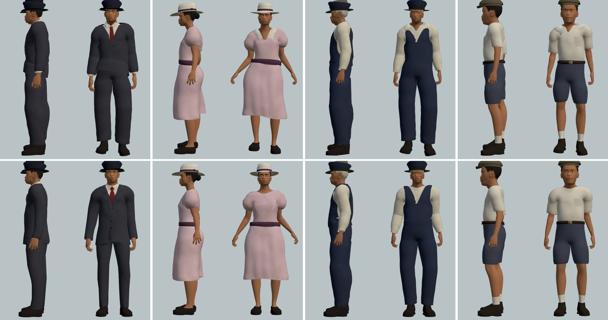
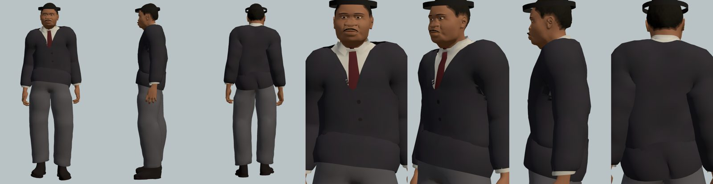
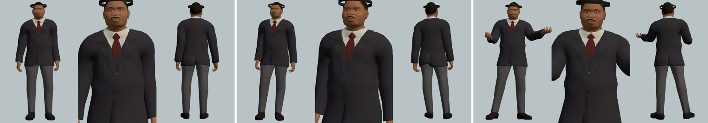
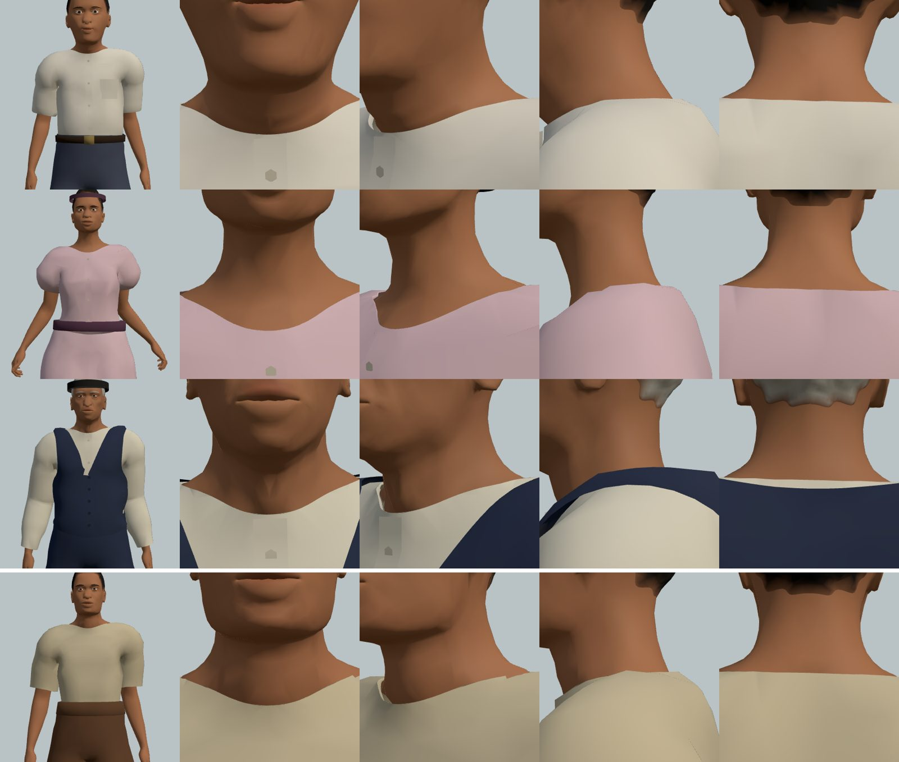
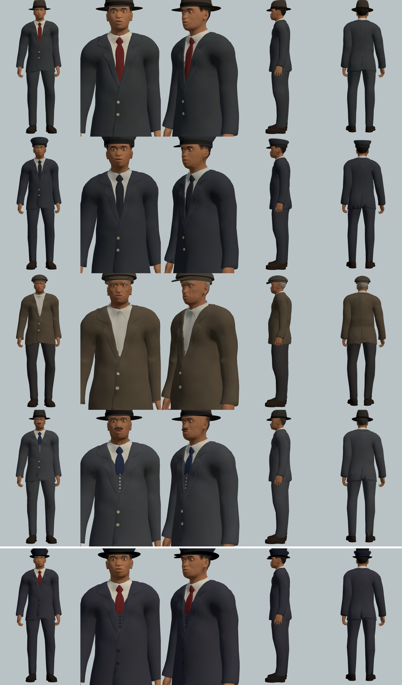
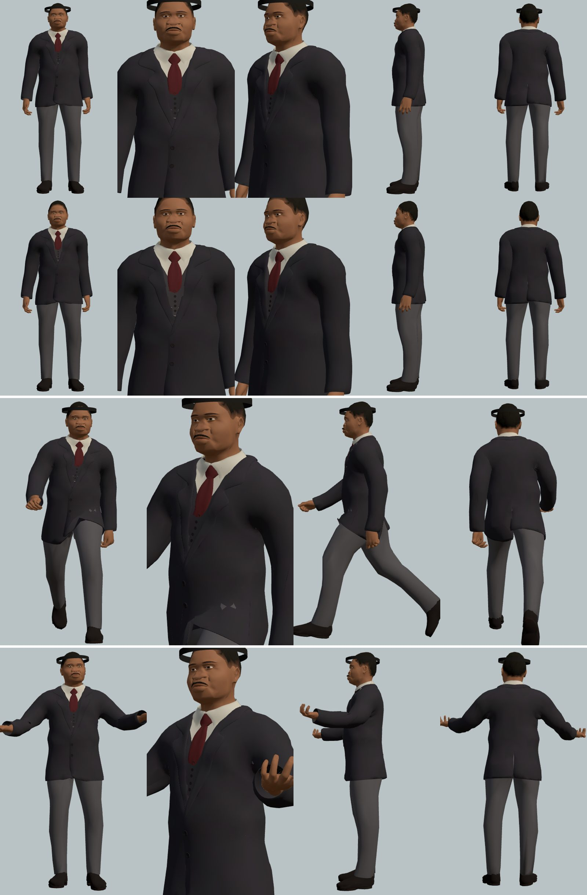
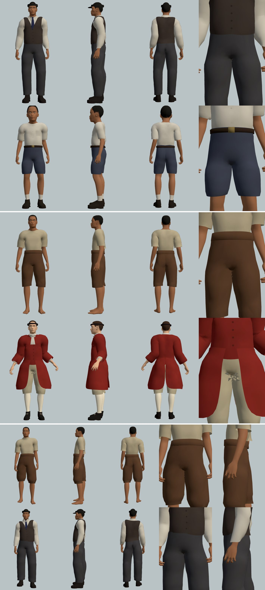
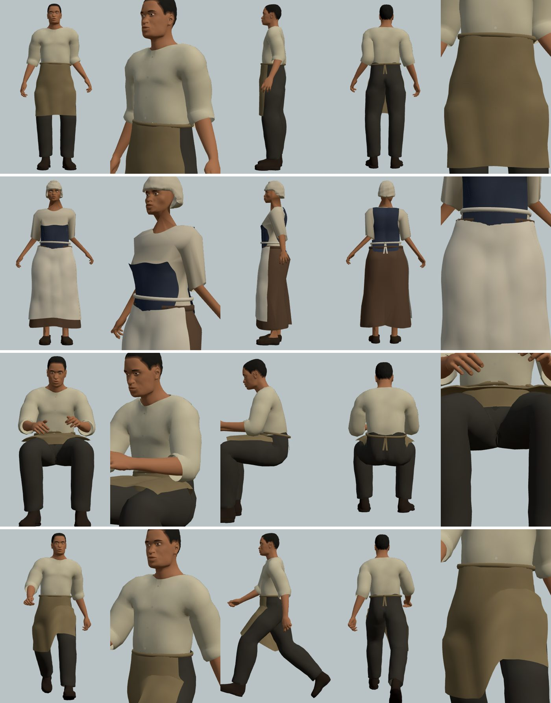
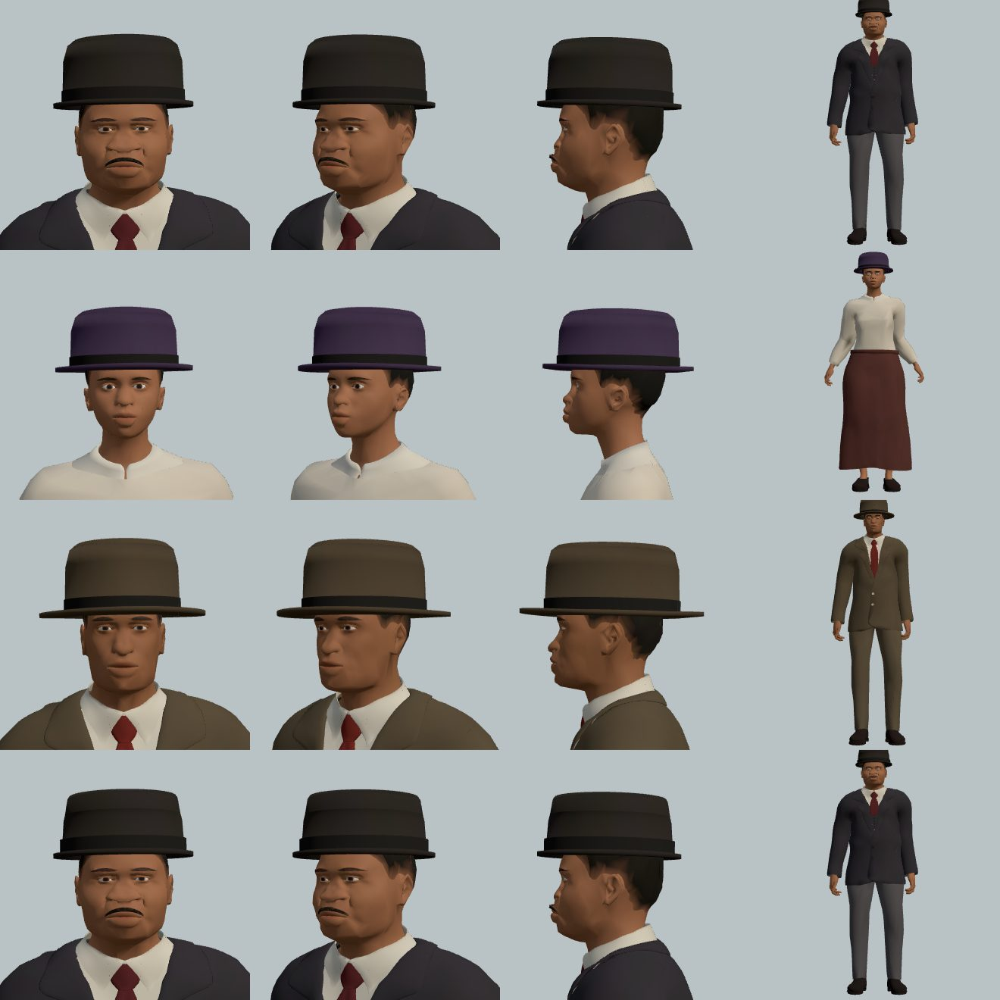
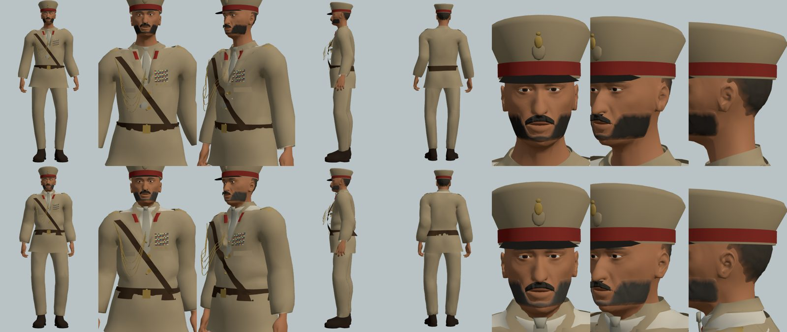

# People: posture, collars, suits and trousers. An honest audit, 21 November 2026

The owner, the same day the collars had been "rebuilt from scratch" (`collars-20261121.md`): the collars are still messed up, Marcus Garvey's suit looks like padding at the shoulders, "his posture is horrible", "he seems to have a curve in his spine", his trouser legs are too wide, the Maroon men's knee breeches "look like horse jockey pants", and: "I don't want to keep patching something that is bad. If we have to start from scratch and rebuild carefully for all existing and future characters, let's do that. Be honest."

This is what was found, what was changed, and what is still not good enough.

## 1. What was actually wrong

**The earlier collar rebuild never reached the games.** The collar code was rewritten that morning, but no body was rebuilt, so every game still shipped the old collars. The owner was looking at the old ones.

**The stoop and the lean were not clothes.** They were in how clips reach bodies, and they were in every game:

- Each body has a skeleton fitted to its own shape, so its bones rest at their own angles. The clips were made on one skeleton and forced every body's bones to that skeleton's rest angles. The body bent by the difference before any clip had moved it. Measured on Marcus Garvey in the plain standing clip: neck 26 degrees forward of the shape he was built in, hips 15 back, shoulders 13 down. On a lean man the neck was 17 degrees forward; on a woman the chest was swayed 15 back and 13 forward again. An earlier fix turned two chest bones by one fixed amount for everyone, which was right for no one.
- The standing clips also rest the weight on one leg: hips tipped 4 to 10 degrees sideways, for the whole clip or for many seconds. On a man in a suit that reads as crooked.

**The clothes follow the body too closely.** The builder does not model garments: it pushes the body's own surface outward and cuts a shirt, a waistcoat or a jacket out of it. That is why:

- sleeves took the shape of the shoulder muscle and the biceps (the "padding", the old man's bodybuilder arms);
- a generated jacket could never have real lapels or a collar, and read as a jumper;
- collars were strips laid on that lumpy cloth, so camp and round collars came out ragged however they were smoothed.

**Marcus Garvey's body was slim.** Under the puffy generated suit his body was an average build with a large head and almost no neck. The suit was doing the work of making him look big, badly.

## 2. What was changed

**Posture, in the engine, for every body in every game** (`docs/ENGINE.md`, "Every body keeps its own shape"):

- `fitRig` lets each body keep the shape it was built in. In the standing clip the trunk is now within 3.5 degrees of rest on every body measured.
- `levelStance` takes the average sideways tip and turn out of every standing clip and keeps a third of the sway.
- No body needed rebuilding for this.

**Necklines.** The owner: "most just need a round opening for the garment." A clean round opening, cut on one smooth seam with a turned-in facing, is now the default for every shirt, blouse and frock. Camp, round and open collars are gone from all 46 recipes that had them. A collar is kept only for a man in a tie, a woman's high-necked blouse of 1908 to 1925, and uniforms; those are the stand and turn collars from the morning's rewrite, which hold up from all four sides.

**Suits are modelled garments now.** A suit modelled once as a clean mesh (jacket with collar and lapels, shirt collar, four-in-hand tie, slim trousers; CC0, MakeHuman community) is fitted to each body by the builder: `docs/PIPELINE.md`, "Fitted garments". It hangs from the chest instead of hugging the body, its lapels are kept at full detail, its sleeves have ease, and it can have a waistcoat or an open collar. Every man in a jacket wears it: both Marcus Garveys, two more men in his game, Kendal's `man_suit` and eight Windrush men. The generated jacket is no longer used.

**Marcus Garvey.** A stout, barrel-chested build (wider and deeper chest, less muscle definition, shorter legs, a neck that shows a collar), not a pot belly: the first try at "stout" read as pregnant and was changed. Three-piece suit with a waistcoat. His face targets are untouched.

**Sleeves** of generated shirts, jackets and coats are one straight taper sized from the arm's own measurements, so they no longer follow the muscles. **Trousers** are fitted (about 8 cm at the thigh to under 6 at the hem). **Knee breeches** narrow steadily to the band, and the Maroon men wear straight open drawers to the knee.

**Aprons** were a flat card hung in front of the legs, standing off the body like a board, with the shirt showing in specks along the top and nothing holding it on. The owner asked for them to be checked and, if they had many edits, started over. They were started over: cloth that wraps the front of the body, a string right round the waist tied at the back, and over a skirt the apron is cut from the skirt itself so the skirt cannot show through.

**Shorts** fall in one straight line from thigh to hem.

**Hats.** The owner asked for the hats to be checked. All 70 hats on all bodies were drawn from the front, three-quarter, side and back, one hat at a time. They sit level on the head at the brow. One kind was wrong: the felt hat of the 1900s to 1920s (Marcus Garvey's and three others) had a flat dished crown with stepped sides and a band standing proud, so it read as three stacked rings perched on the head. It now has a rounded crown and a ribbon at its base.

**Found on the way:** on women, children and old people the round opening ran out onto the shoulders and skin showed through the blouse there. The opening now keeps to the neck's own size.

**The Emperor** (owner: hunched shoulders, choppy clothes, the beard). Squarer shoulders and a longer neck, his tunic's sleeves and skirt put right, a smooth belt, a closer and darker beard. His tunic is still a generated jacket, and the beard's edge is still hard: both are listed.

## 3. What is still not good enough (said plainly)

- **Everyday clothes are still made by pushing the body's surface outward.** Their worst faults are fixed at the root (posture, sleeves, necklines, legs), but a shirt still takes the body's shape more than real cloth would, and the builder is still 1,800 lines of dense code. The right long-term answer is the one used for suits: model each period garment once on the standard body and fit it. The free library was checked for this: it has suits, but no period shirts, blouses, frocks, coats or breeches, so those pieces would have to be modelled here. That is a real piece of work, not done in this pass.
- **The fitted suit is a modern cut** (two buttons, notched lapels). It is right for 1948 to 2018. For Marcus Garvey in 1914 to 1920 a higher-buttoning three-button jacket would be more exact. Listed in `docs/TODO.md`.
- **Stand collars under the fitted suit.** Garvey in 1914 wore a stiff stand collar; the fitted suit has a turn-down collar.
- **A stride can still show a speck of trouser at the jacket's front hem** on the fitted suit.
- **Eventide's own three bodies and the Emperor's uniform** are built by their own scripts and were not rebuilt; they get the posture fix like everyone else.
- **Shoulders.** The suit's shoulder line follows the body's slope. A tailored shoulder is a little squarer.
- **Later the same day (owner: "waistcoats still follow the belly", "not a tailored shoulder", "these peak at the shoulder", "the strap is broken at the shoulder").** A generated waistcoat's front now falls in one straight line from chest to hem. A shirt's shoulder top is raised to a straight line from neck to sleeve (at most 12 mm, nothing at the two ends), and the head of the sleeve is rounded over toward the arm so the shoulder tip does not stand up as a corner. The Emperor's shoulder strap turns over the shoulder as one even band, kept 7 mm clear of the cloth.
- **A seated man's apron** lies on his lap as a short flap instead of falling over his knees.
- **A mistake made and caught in this pass:** the new sleeve rule first went onto the 1690 coats too and their sleeves came out in rings. It was found by rendering a coated man beside the same man on main, and the coats got their own rule back. Every garment kind was then compared with main the same way.

## 4. How to keep this from happening again

1. A stooped or crooked body is measured before anything is changed: `node tools/review/posture-probe.mjs <game> <id>`. Stance belongs to the engine, never to a recipe or a garment.
2. Clothes are looked at from the front, three-quarter, side and back, standing, walking and seated, in a pale colour as well as their own (a dark suit hides soft lapels and stepped edges).
3. A builder change is not finished until bodies are rebuilt and looked at in the game's stance. The morning's collar rewrite was documented as done with no body rebuilt.
4. New people get `"collar": false` unless the period and the person need a collar, and a man in a jacket gets the fitted suit.
5. When a garment is needed often, model it once and add it to `shared/garments/`. Do not add another special case to `era.py`.
6. After a change to shared cloth code, one body of every garment kind is rendered beside the same body on main before anything is rebuilt into the games.
7. `npm test` now fails if a standing clip leans (`tests/posture.mjs`) or if a body would bend when fitted (`tests/fit-rig.mjs`).
